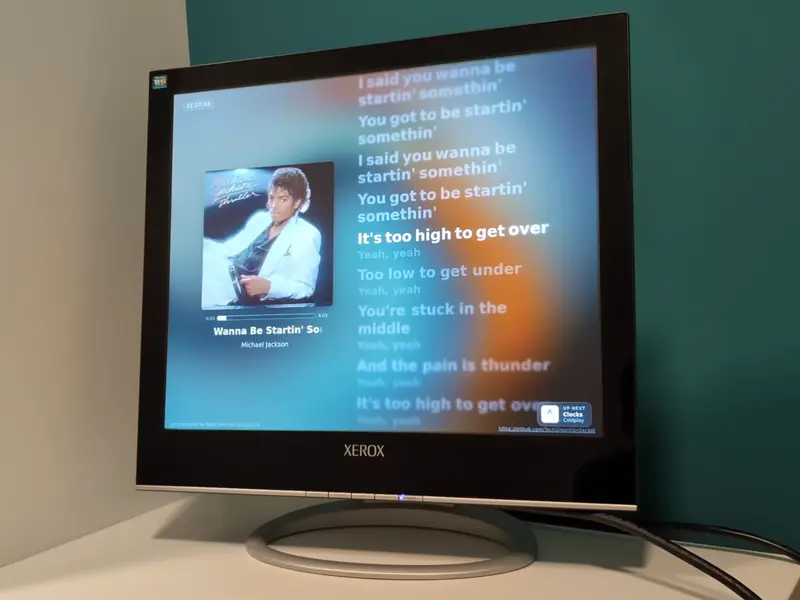

# Syllacast

Network-synchronized Spotify lyrics display server and WebGL karaoke visualizer for kiosks, single-board computers, smart displays, desktops, and web browsers integrating with [Spotify Soloist](https://developer.spotify.com/documentation/soloist/).

Built with a high-performance **Rust backend** (Axum, Tokio) and a lightweight **TypeScript + WebGL frontend** featuring a faithful port of the [Spicy Lyrics](https://github.com/Spikerko/spicy-lyrics) typography and physics animation engine.

  

---

## Features

- **Word-by-word Synchronized Karaoke**: Smooth second-order spring physics and cubic splines for letter/word gradient sweeping, scale pulse, and dynamic text glow.
- **Dynamic Fluid Background**: Real-time WebGL fluid simulation powered by `@kawarp/core` driven by the current album artwork.
- **Single Self-Contained Binary**: All HTML, CSS, JavaScript, and WebGL assets embedded directly into the Rust executable via `rust-embed` with zero external runtime file dependencies.
- **Interactive TUI Setup Wizard**: Run `syllacast setup` for a guided Ratatui terminal wizard that verifies API keys, detects Spotify Soloist, and auto-configures `systemd`.
- **Sub-Second NTP Clock Synchronization**: 4-timestamp RTT exchange between browser and server to eliminate Wi-Fi latency jitter.
- **Queue & Up Next Display**: Live upcoming track card previewing the next queued song.
- **Automated GitHub Release Updates**: Optional in-app update notifications with release notes, channel selection, and atomic verified binary replacement.
- **Remote Kiosk Control**: Real-time settings web dashboard to toggle overlays, switch modes (Standard vs Cinema), adjust calibration offset, and configure layout.
- **Static Musl Multi-Arch**: Prebuilt zero-glibc static binaries for `x86_64`, `aarch64`, and `armv7` (Raspberry Pi 2/3/4/5).
- **AGPL-3.0 Compliant**: Persistent network source code availability and discrete upstream provider attribution.

---

## Getting Started & Documentation

- **[Setup & Deployment Guide](SETUP.md)**: Step-by-step setup, configuration options, deployment scenarios (Desktop, Raspberry Pi/SBC appliance, Docker), and troubleshooting.
- **[Building Instructions](BUILDING.md)**: Detailed compilation instructions for the Rust backend, Vite frontend, Docker container images, and ARM64 cross-compilation.
- **[Configuration Template](.env.example)**: Full reference template of all available environment variables and CLI options.
- **[Attribution & Licenses](ATTRIBUTION.md)**: Upstream credits, component licenses, and third-party dependencies.

---

## Upstream Credits & Attribution

Syllacast's lyrics typography engine, dynamic WebGL background canvas, and styling are directly derived from the open-source **[Spicy Lyrics](https://github.com/Spikerko/spicy-lyrics)** Spicetify extension created by **Spikerko**.

- **Upstream Repository**: [https://github.com/Spikerko/spicy-lyrics](https://github.com/Spikerko/spicy-lyrics)
- **Author**: Spikerko ([GitHub](https://github.com/Spikerko))
- **Support the Creator**: Donate to Spikerko on [Ko-fi](https://ko-fi.com/spikerko) · Join the Spicy Lyrics community on [Discord](https://discord.gg/lyrc)

For comprehensive licensing notices, third-party library details, and component lists, please see [ATTRIBUTION.md](ATTRIBUTION.md).

---

## Source Code & AGPL-3.0 Compliance

In accordance with **Section 13 of the GNU Affero General Public License v3.0**, all users interacting with this service over a network have access to the Corresponding Source code at no charge:

- **Source Code**: [https://github.com/TechGigant/syllacast](https://github.com/TechGigant/syllacast)

---

## License

This project is licensed under the **GNU Affero General Public License v3.0 (AGPL-3.0)**.
See [LICENSE](LICENSE) for the full license text.
