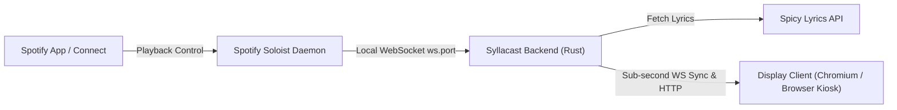

# Syllacast Setup & Deployment Guide

This guide walks you through setting up and running **Syllacast**, from initial API registration to full deployment on desktops, single-board computers (such as a Raspberry Pi), or Docker containers.

---

## 1. Architecture Overview



Syllacast connects to two external components:
1. **[Spotify Soloist](https://developer.spotify.com/documentation/soloist/)**: The local Spotify Connect player daemon running on your device or network. It streams playback position, track IDs, album artwork, and play/pause events over WebSocket.
2. **[Spicy Lyrics API](https://developers.spicylyrics.org/)**: Provides word-by-word, syllable-synchronized karaoke lyrics, translations, and romanized text.

---

## 2. Prerequisites

### 1. Spicy Lyrics API Secret Key
Syllacast uses the Spicy Lyrics API to retrieve time-synced syllable lyrics

### 2. Spotify Soloist
Spotify Soloist is Spotify's official lightweight Connect playback engine for Linux devices and appliances.
- It writes runtime discovery files (`ws.port` and `ws.addr`) in its Linux data directory (e.g. `/var/lib/soloist` or `~/.local/share/soloist`).
- Because Soloist runs on Linux, if you run Syllacast on another machine or OS during development, you can point Syllacast to your Linux Soloist instance over your local network using the `SOLOIST_WS_URL` setting (e.g. `ws://192.168.1.50:9090`).

---

## 3. Configuration Reference

Syllacast can be configured using command-line arguments or environment variables. A template is provided in [`.env.example`](.env.example).

| CLI Flag | Environment Variable | Default Value | Description |
| :--- | :--- | :--- | :--- |
| `-p`, `--port` | `SYLLACAST_PORT` | `8080` | Port for the HTTP server and client WebSocket |
| `-b`, `--bind` | `SYLLACAST_BIND` | `0.0.0.0` | IP address to bind to (`0.0.0.0` binds to all interfaces) |
| `--spicy-key` | `SPICY_LYRICS_SECRET_KEY` | *(None)* | Your Spicy Lyrics API key (`sl_sk_...`) |
| `--spicy-api-url` | `SPICY_LYRICS_API_URL` | `https://api.spicylyrics.org/v1/lyrics` | Base URL for the Spicy Lyrics REST API |
| `--soloist-ws` | `SOLOIST_WS_URL` | *(Auto-discovered)* | Explicit WebSocket URL for Soloist (e.g. `ws://127.0.0.1:9090`) |
| `--soloist-data-dir` | `SOLOIST_DATA_DIR` | *(Auto-detected)* | Path to directory containing Soloist's `ws.port` and `ws.addr` |
| `--config-dir` | `SYLLACAST_CONFIG_DIR` | OS user config dir | Directory for storing persistent settings (`settings.json`) |
| `--cache-dir` | `LYRICS_CACHE_DIR` | OS user cache dir | Directory for caching fetched lyrics on disk (30-day TTL) |
| `--frontend-dist` | `FRONTEND_DIST` | `frontend/dist` | Path to compiled frontend assets |
| *(None)* | `SYLLACAST_BIN_PATH` | *(Current executable)* | Destination binary path for automated updates (supports custom paths) |

---

## 4. Deployment Scenarios

### Scenario A: Local Desktop / Development Setup

Use this to run Syllacast on your personal computer (Windows, macOS, or Linux).

1. **Build or extract Syllacast**:
   Follow [BUILDING.md](BUILDING.md) to generate the binary and `frontend/dist`.

2. **Configure your environment**:
   Copy `.env.example` to `.env`:
   ```bash
   cp .env.example .env
   ```
   Open `.env` and fill in your API key (and point to your Linux device running Soloist if developing from a separate PC):
   ```env
   SPICY_LYRICS_SECRET_KEY=sl_sk_your_key_here
   # If Soloist is running on a Raspberry Pi or Linux board on your local network:
   # SOLOIST_WS_URL=ws://192.168.1.50:9090
   ```

3. **Start the server**:
   ```bash
   # Linux / macOS
   ./target/release/syllacast

   # Windows
   .\target\release\syllacast.exe
   ```

4. **Open the web display**:
   Navigate to `http://localhost:8080` in your web browser. Start playing music to your Spotify Soloist player to watch real-time lyrics.

---

### Scenario B: Dedicated Raspberry Pi or Linux SBC Appliance

This setup runs Syllacast as a persistent background `systemd` service alongside Spotify Soloist, turning your board into a standalone lyrics kiosk.

Because Syllacast embeds all frontend web assets directly inside a single static binary, **no external assets directory or Node.js runtime is required on the device**.

#### Option 1: Interactive Terminal Setup Wizard (Recommended)

Syllacast includes a built-in terminal UI setup wizard powered by Ratatui:

```bash
# Run the interactive wizard
sudo ./syllacast setup
```

The wizard will:
1. Prompt for and validate your Spicy Lyrics API key.
2. Auto-detect Spotify Soloist and test local WebSocket connectivity.
3. Configure bind address and port (defaulting to `0.0.0.0:8080`).
4. Automatically write `/etc/syllacast/syllacast.env`.
5. Automatically generate, enable, and start `/etc/systemd/system/syllacast.service`.

---

#### Option 2: Manual Service Installation

If you prefer to configure systemd manually:

1. **Install binary on the device**:
   ```bash
   sudo mkdir -p /opt/syllacast
   sudo cp syllacast /opt/syllacast/
   sudo chmod +x /opt/syllacast/syllacast
   ```

2. **Create configuration directory**:
   ```bash
   sudo mkdir -p /etc/syllacast
   sudo nano /etc/syllacast/syllacast.env
   ```
   Insert your configuration:
   ```env
   SPICY_LYRICS_SECRET_KEY=sl_sk_your_key_here
   SYLLACAST_PORT=8080
   SYLLACAST_BIND=0.0.0.0
   ```

3. **Create the `systemd` service unit**:
   ```bash
   sudo nano /etc/systemd/system/syllacast.service
   ```
   Paste the following service definition:
   ```ini
   [Unit]
   Description=Syllacast Spotify Lyrics Display Service
   After=network-online.target
   Wants=network-online.target

   [Service]
   Type=simple
   User=soloist-appliance
   Group=soloist-appliance
   WorkingDirectory=/opt/syllacast
   EnvironmentFile=/etc/syllacast/syllacast.env
   ExecStart=/opt/syllacast/syllacast
   Restart=always
   RestartSec=5s

   # Security hardening
   ProtectSystem=full
   ProtectHome=read-only
   NoNewPrivileges=true

   [Install]
   WantedBy=multi-user.target
   ```

4. **Enable and start the service**:
   ```bash
   sudo systemctl daemon-reload
   sudo systemctl enable --now syllacast.service
   ```

5. **Verify service status**:
   ```bash
   sudo systemctl status syllacast.service
   journalctl -u syllacast.service -f
   ```

6. **Display on Screen (Kiosk Mode)**:
   If your board is plugged into an HDMI screen or TV, launch Chromium in kiosk mode:
   ```bash
   chromium-browser \
     --kiosk \
     --noerrdialogs \
     --disable-infobars \
     --check-for-update-interval=31536000 \
     --ozone-platform=wayland \
     http://localhost:8080
   ```
   *(Alternatively, use digital signage managers such as Anthias).*

---

### Scenario C: Docker Container Deployment

1. **Using Docker Compose**:
   Create a `docker-compose.yml` file:
   ```yaml
   services:
     syllacast:
       build: .
       container_name: syllacast
       restart: unless-stopped
       ports:
         - "8080:8080"
       environment:
         - SPICY_LYRICS_SECRET_KEY=sl_sk_your_key_here
         - SOLOIST_WS_URL=ws://192.168.1.50:9090 # Address of your Soloist daemon
       volumes:
         - syllacast-config:/root/.config/syllacast
         - syllacast-cache:/root/.cache/syllacast

   volumes:
     syllacast-config:
     syllacast-cache:
   ```

2. **Start the container**:
   ```bash
   docker compose up -d
   ```

---

## 5. In-App Controls & Customization

Syllacast features an authentic replica of the Spicy Lyrics controls. All settings are persisted automatically in `settings.json` and sync across connected clients.

- **Romanization Pill (`a` / `あ`)**:
  Located in the floating pill dock at the bottom-right. Toggles Latin transliteration for languages using non-Latin scripts (e.g. Japanese, Korean, Russian).
- **NowBar Toggle**:
  Collapses or expands the album artwork and song details panel (`.NowBarStatus__Open` / `.NowBarStatus__Closed`).
- **NowBar Side Switch**:
  Swaps the NowBar between the left and right side of the screen (`.NowBarSide__Left` / `.NowBarSide__Right`).
- **Display Control Modal / Gear Icon**:
  Click the gear icon or navigate directly to `http://localhost:8080/settings.html` to open the control panel:
  - **Calibration Offset (ms)**: Fine-tune lyrics timing relative to your sound output (useful for compensating for Bluetooth or HDMI audio latency).
  - **Display Mode**: Switch between Standard dual-panel view and Cinema fullscreen view.
  - **Software Updates & GitHub Releases**:
    - **Update Modes**: Choose between `Notify` (displays a discrete in-app banner with Release Notes and a one-click install button), `Automatic` (installs updates in the background and gracefully restarts the service), or `Disabled`.
    - **Release Channel**: Select `Stable` (recommended) or `Prerelease`.
    - **Integrity Validation**: Packages are cryptographically verified against published SHA-256 checksums before atomic binary replacement.
  - **Diagnostic Status**: View live Soloist WebSocket status, round-trip clock sync latency, and cached song stats.

---

## 6. Troubleshooting

### "Soloist Disconnected" or "Soloist not discovered"
- Ensure Spotify Soloist is running on the host and generating `ws.port`.
- If Soloist is running in an unconventional directory, pass `--soloist-data-dir /path/to/data` or configure `SOLOIST_DATA_DIR`.
- If Soloist is on another machine, explicitly configure `SOLOIST_WS_URL=ws://<ip>:<port>`.

### "No lyrics found" or "API rate limit"
- Verify that your `SPICY_LYRICS_SECRET_KEY` is set correctly in `.env` or systemd environment.
- Check backend logs:
  ```bash
  RUST_LOG=info,syllacast=debug ./syllacast
  ```
- Syllacast caches all fetched lyrics locally for 30 days to optimize network bandwidth and comply with upstream terms.

### Lyrics Out of Sync with Audio
- Open the settings panel (`/settings.html` or gear icon).
- Adjust the **Calibration Offset** slider (e.g. `+200ms` if lyrics are lagging behind, or `-200ms` if lyrics appear ahead of the vocals).
- Syllacast includes continuous sub-second NTP clock synchronization to automatically eliminate network jitter between the server and the display client.
